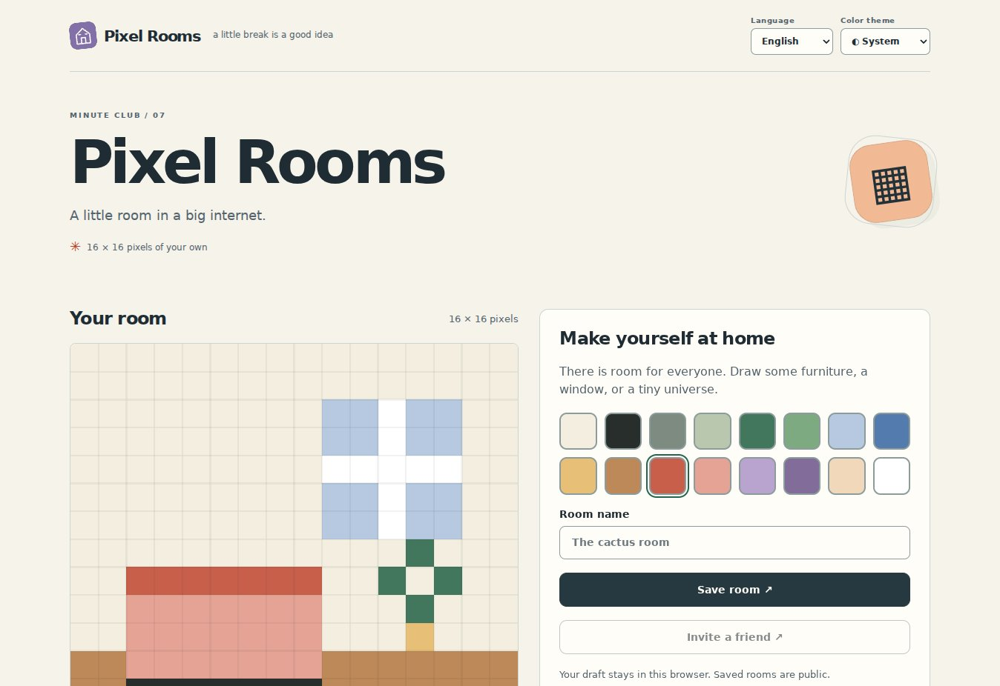

<div align="center">


# Pixel Rooms

**A small room in a shared world.**

Decorate a pixel room and explore a house built by its visitors.

**English** · [Русский](README.ru.md)

  

</div>

[Features](#features) · [Stack](#technology-stack) · [Quick start](#quick-start) · [License](LICENSE)



*Actual local application capture with an empty test database; this is not audience activity.*

## Features

- Your own 16×16 room
- Public gallery of community rooms
- Local drafts before saving to the shared house

**Try the flow: Paint → save → explore the house.**

Documentation: English / Русский. App interface: English, Русский, selected from browser preferences or manually. System theme by default, with explicit light and dark modes. The system mode follows device changes; your choice is saved locally.

## Technology stack

| Layer | Implementation |
| --- | --- |
| Interface | HTML · CSS · JavaScript / native ES modules |
| Runtime | Node.js 24+ · SQLite |
| Development | JavaScript |
| Dependencies | No third-party browser libraries or remote fonts |

## Quick start

Requires Node.js 24+. No install or build step.

```sh
npm start
```

Open http://localhost:3000. The root opens this application; unrelated app routes and APIs are disabled. Data persists in `data/minute.sqlite`.

```sh
npm test
npm run check
```

## Deploy

Set `PUBLIC_ORIGIN` to the exact HTTPS origin, give the process a persistent `DATA_DIR`, and put an HTTPS reverse proxy in front. Example Dockerfile, Caddy config, environment file, and systemd unit are included. Each independent project needs its own port and data directory. `.env` is not loaded automatically: use exported variables or `node --env-file=.env server/index.mjs`. See [OPERATIONS.md](OPERATIONS.md) for backups, moderation, identity limitations, and storage details.

Every browser owns one 16×16 room. The gallery is public, room writes check ownership and version, and drafts stay local until saved. The HMAC-signed cookie is the key: clearing cookies loses edit access. There is no recovery/account system in v1.

---

[More by den9911](https://github.com/den9911) · [Report an issue](https://github.com/den9911/pixel-rooms/issues) · [LICENSE](LICENSE)
